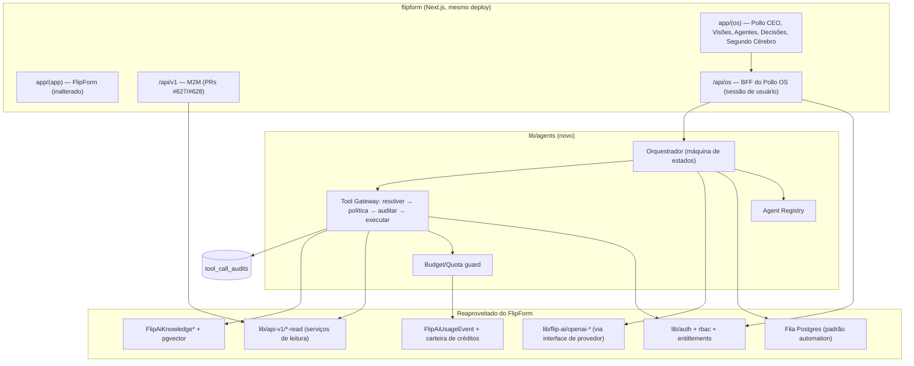

# ADR-001 — Arquitetura do Pollo OS / Pollo CEO sobre o FlipForm

**Status:** PROPOSTA (21/11/2026). Não autoriza merge, migration, deploy nem alteração de produção.

> **Revisão do proprietário (21/11/2026):** **D1 e D2 rejeitadas.** O Pollo OS será construído **como aplicação própria, separada do FlipForm**, e o FlipForm será **conectado depois**, por API (`/api/v1` dos PRs #627/#628) e SSO. Continuam válidos: o inventário, a auditoria Openbox, os três níveis de agentes, o Tool Gateway, o esquema `agent_*`, as regras de segurança e o PR A1 (que passa a nascer no repositório `pollo-os`, não no `flipform`). Antes de codificar, o proprietário quer **visualizar o sistema** (protótipos em `prototipos/`).
**Base:** `flipform@main 6def5c5`, PRs #627 `0491f415` e #628 `94159127`, Plano Mestre v6.1, Prompt Mestre v1.

---

## 1. Decisões propostas

| # | Decisão | Alternativas | Por quê | Risco | Status |
|---|---|---|---|---|---|
| D1 | **Evoluir dentro do repositório `flipform`**, em módulos novos (`lib/agents/*`, `lib/pollo-os/*`, `app/(os)/*`), sem runtime externo | (b) app separado; (c) importar OpenBot/Openbox | Reusa auth, RBAC, tenant, Flip AI, fila e auditoria; Plano §14.1 proíbe três mecanismos desconectados; (c) é inviável por licença (ver `openbox-reuse-audit.md`) | Repositório já grande (1.593 arquivos) | Recomendado |
| D2 | **Pollo OS servido pelo mesmo app Next.js**, por host (`lib/host-routing.ts` já existe) | App separado com SSO | Mesmo cookie de sessão resolve o "sem novo login" sem SSO entre domínios no MVP; SSO real fica para quando houver app separado (Flip Intelligence) | Acoplamento de deploy | **Pendente** (depende da topologia de domínios, Plano §03.2) |
| D3 | **Motor de execução = fila durável em Postgres** no padrão de `lib/automation/execution-engine.ts` (`SKIP LOCKED`, tentativas, recuperação), com drenagem por rota interna + `CRON_SECRET` | (b) filas/workflows gerenciados da Vercel; (c) worker dedicado (Railway/Fly) | Já testado em produção no FlipForm, sem custo novo; suficiente para runs **read-only curtos** (E3–E5) | `maxDuration` de 60 s por drenagem; não serve para reuniões longas nem para delegação extensa | Recomendado até E5; **reavaliar no E8** com custo medido |
| D4 | **Pollo CEO lê dados por serviços tipados**, reusando os mesmos serviços de leitura do `/api/v1` (`lib/api-v1/*-read.ts`) com **identidade de serviço** por tenant, e não por HTTP nem SQL | Chamar a própria API HTTP; SQL direto | Uma regra de autorização só; sem SQL irrestrito (invariante do Prompt Mestre) | Depende do merge de #627/#628 | Recomendado |
| D5 | **Modelos: interface de provedor** sobre `lib/flip-ai/openai-responses.ts`; registrar provedor/modelo/tokens em `FlipAiUsageEvent` (+ `runId`) | Adotar SDK multiprovedor já | Evita dependência nova antes de haver necessidade; roteamento por custo é E10 | Provedor único até lá | Recomendado |
| D6 | **Tabelas novas aditivas** com prefixo `agent_`/`decision_`; **não duplicar** `Task`, `AuditLog`, `WebhookEvent`, `FlipAiUsageEvent` | Reusar `AuditLog` para chamadas de ferramenta | `AuditLog` não tem run/correlação e convive com o fallback de tenant de `platform-audit` | Mais tabelas | Recomendado |
| D7 | **O Pollo CEO é um perfil da fundação Flip**, não um produto de IA paralelo; a franquia passa pelo serviço de quota atômico (Plano PR 11) | Quota própria | Evita bypass do limite de 3/dia via Pollo OS (Plano §14.1.1) | Depende do PR 11 | Recomendado |

## 2. Arquitetura alvo



Fluxo de um pedido ao CEO: `POST /api/os/ceo/conversations/{id}/messages` → sessão + tenant + papel + plano → run `requested → validated → planned → queued → running` → o modelo escolhe ferramentas **somente do catálogo liberado** → cada chamada passa pelo Gateway → resposta com evidências (`sourceType`, período, `observedAt`, qualidade) → run `completed`, com custo gravado.

## 3. Mapa dos três níveis de agentes

| Nível | Agente | Situação real | Ferramentas (fase) | Autonomia inicial |
|---|---|---|---|---|
| **Estratégico** | **Pollo CEO** | ∅ (visão) | Ler visão geral, KPIs, funis, tarefas e conhecimento; criar **rascunho** de plano (E5); propor decisão (E8) | `advice_only` |
| Tático-analítico | Analista de Funil | ∅, mas dados existem (`LeadStageHistory`, `lib/dashboard-metrics.ts`, `lib/reports`) | Conversão por etapa/canal/tempo; comparação de períodos | `advice_only` |
| Tático-analítico | Flip (Intelligence) | ∅ (Plano PRs 08–11) | Métricas da empresa e mercado | `advice_only` |
| Tático-analítico | Analista de Mercado | ∅ | Fontes externas com allowlist (reusar `external-web-search` sob gateway) | `advice_only` |
| Operacional | Flip AI (atendimento de lead) | **M**, em uso | Já existentes; **não** expostos ao CEO no MVP | Inalterada |
| Operacional | IA WhatsApp / Instagram | **M** | Idem | Inalterada |
| Operacional | Tarefas por IA (`team-task`) | **M** | CEO pode **propor** tarefa (E8, com aprovação) | `execute_with_approval` (E8) |
| Operacional | Motor de automação | **M** | Fora do alcance do CEO | — |
| Operacional | Humanos (atendentes, gestores) | real | Recebem tarefas e aprovações | — |

Regra: **nenhum agente cria agentes**. A delegação é um handoff tipado `{objective, constraints, expectedOutput, allowedTools, budgetCents, deadline}` com profundidade ≤ 2 e passos ≤ 8 por run (valores a calibrar).

## 4. Esquema de dados proposto (aditivo, não criado)

```prisma
model AgentDefinition {        // catálogo por tenant (null = definição da plataforma)
  id String @id @default(uuid())
  tenantId String?            // null = agente padrão Pollo
  key String                  // "pollo_ceo", "funnel_analyst"
  level String                // strategic | tactical_analytical | operational
  status String @default("draft") // draft | active | disabled
  @@unique([tenantId, key])
}
model AgentVersion {           // imutável depois de publicada
  id String @id @default(uuid())
  agentId String
  version Int
  instructions String
  model String
  autonomy String             // advice_only | prepare_only | execute_low_risk | execute_with_approval
  limits Json                 // maxSteps, maxDepth, maxToolCalls, budgetCents, timeoutMs
  publishedAt DateTime?
  @@unique([agentId, version])
}
model AgentToolGrant { id String @id @default(uuid()); tenantId String; agentVersionId String; toolKey String; toolVersion Int; @@unique([tenantId, agentVersionId, toolKey]) }
model AgentRun {
  id String @id @default(uuid())
  tenantId String; agentVersionId String; requestedBy String  // userId
  parentRunId String?; depth Int @default(0)
  status String               // requested|validated|planned|queued|running|waiting_approval|completed|failed|cancelled
  idempotencyKey String; correlationId String
  budgetCents Int; spentCents Int @default(0)
  startedAt DateTime?; finishedAt DateTime?; error String?
  @@unique([tenantId, idempotencyKey])
  @@index([tenantId, status, startedAt])
}
model AgentStep { id String @id @default(uuid()); tenantId String; runId String; ordinal Int; kind String /* model|tool|handoff|checkpoint */; status String; startedAt DateTime; finishedAt DateTime?; @@unique([runId, ordinal]) }
model ToolCallAudit {          // gravado ANTES de executar; atualizado com o resultado
  id String @id @default(uuid())
  tenantId String; runId String; stepId String
  actorUserId String?; serviceIdentity String
  toolKey String; toolVersion Int; effect String // read | write | external
  decision String             // allow | deny | needs_approval
  reason String; argsHash String; argsRedacted Json
  outcome String?             // ok | error | skipped
  createdAt DateTime @default(now())
  @@index([tenantId, createdAt]); @@index([runId])
}
model DecisionProposal { id String @id @default(uuid()); tenantId String; runId String?; status String /* proposed|approved|executing|executed|failed|reverted|rejected */; payload Json; payloadHash String; evidence Json; risk String; createdBy String; @@index([tenantId, status]) }
model DecisionApproval { id String @id @default(uuid()); tenantId String; proposalId String; payloadHash String; decidedBy String; decision String; reason String?; decidedAt DateTime @default(now()); @@unique([proposalId, decidedBy]) }
```

Reuso, sem tabela nova: `FlipAiUsageEvent` (+ `runId` opcional) para consumo; `FlipAiKnowledge*` para conhecimento (+ ACL e tipo no E4); `Task` (+ `sourceRunId` opcional no E8). Toda FK com `tenantId` composto, no padrão já usado (`@@unique([tenantId, id])`).

## 5. Interfaces e segurança

```ts
type ToolEffect = 'read' | 'write' | 'external';
interface ToolDefinition<I, O> {
  key: string; version: number; level: OrganizationLevel[];
  effect: ToolEffect;
  requiredScopes: string[];      // ex.: 'pipelines.read'
  requiredEntitlement?: string;  // ex.: 'premium_pro'
  minAutonomy: AutonomyLevel;
  input: ZodType<I>; output: ZodType<O>;
  execute(ctx: ToolContext, input: I): Promise<O>; // ctx traz tenantId da sessão, nunca do argumento
}
```

Ordem obrigatória no Gateway: **(1)** validar `input` (schema estrito) → **(2)** resolver tenant/ator/escopos/plano/autonomia a partir do contexto do servidor → **(3)** política: negar antes de permitir; política ausente/quebrada = negar; erro em controle crítico de escrita = negar → **(4)** gravar `ToolCallAudit` (falhou a gravação = não executa) → **(5)** checar orçamento/quota atomicamente → **(6)** executar com timeout → **(7)** sanitizar a saída e atualizar a auditoria.

Invariantes testáveis: `tenantId` jamais vem de argumento do modelo · conteúdo de documento/página/mensagem é **dado**, nunca instrução de política · ferramentas `write`/`external` ficam fora do catálogo até E8 · nenhum segredo em prompt, log ou auditoria (`argsRedacted`) · repetição com o mesmo `idempotencyKey` = um efeito.

## 6. Dependências e encaixe no roadmap oficial

```
PR00 (P0 #624, #625 + gates A2) ──► PR01 #627 ──► PR02 #628 ──► PR03 (tarefas/agenda)
                                         │
     A1 (contratos + gateway puro) ◄─────┘ independe de schema; pode correr em paralelo ao PR00
     A2 (schema agent_*/tool_call_audits) ── após E1 e gate de migration
     A3 (1ª tool read-only: resumo de pipelines) ── após #627 mergeado
     A4 (executor de run na fila Postgres) ── após A2
     A5 (Pollo CEO consultivo, flag OFF) ── = recorte do Plano PR 12, depois de PR 11 (quota)
```

## 7. Épicas → PRs pequenos

| Épica | PRs (identificadores internos, não números do GitHub) | Gate |
|---|---|---|
| E0 | **D0**: levar estes 4 documentos para `flipform/docs/architecture/` (somente docs) | Autorização do proprietário |
| E1 | Fechar PR00 (#619–#626) → #627 → #628 pelo fluxo já em curso | Gates do PR01 (NO-GO atual) |
| E3 | **A1** contratos + gateway puro · **A2** schema aditivo · **A3** primeira tool read-only · **A4** executor de run · **A6** tela Agentes & Operações (estados reais) | A2 exige migration aprovada |
| E4 | **K1** tipo + validade + ACL em `FlipAiKnowledgeDocument` · **K2** busca com ACL antes do vetor · **K3** biblioteca (lista) | Governança LGPD |
| E5 | **C1** BFF `/api/os/ceo` + conversa texto · **C2** evidências e frescor · **C3** visão executiva (3 KPIs) | Plano PR 11/12 |
| E7 | **V1** áudio gravado + transcrição (reusa `openai-transcription`) · **V2** voz contínua | Plano PR 12/13 |
| E8 | **X1** DecisionProposal/Approval atômico · **X2** criar `Task` com aprovação | E3–E5 homologados |
| E9 / E10 | Conectores homologados · interface multiprovedor e roteamento por custo | Dados reais de uso |

## 8. Primeiro PR implementável — **A1: núcleo de agentes (contratos + Tool Gateway puro)**

**Por que este primeiro:** é o único que **não depende** de PR em draft, de migration, de staging nem de dado real, e trava desde o primeiro dia as regras de segurança que todos os outros vão usar.

**Escopo (arquivos novos, nada existente alterado):**
- `lib/agents/contracts.ts`: tipos e schemas Zod (`OrganizationLevel`, `AutonomyLevel`, `AgentRunStatus`, `Evidence`, `DelegatedTask`, `ToolDefinition`, `ToolContext`, `RunLimits`).
- `lib/agents/run-state.ts`: máquina de estados pura com transições válidas.
- `lib/agents/tool-gateway.ts`: o pipeline das 7 etapas da §5, com **portas injetáveis** (`AuditSink`, `BudgetGuard`, `PolicySource`), sem Prisma e sem rede.
- `lib/agents/policy.ts`: avaliação deny-first e fail-closed.
- `lib/agents/limits.ts`: profundidade, passos, chamadas de ferramenta, orçamento, detector de repetição.
- `tests/agents-core.test.ts`: `tsx --test`, só dados sintéticos; incluir no passo de testes tsx do `ci.yml`, que é a única alteração em arquivo existente.

**Fora de escopo:** Prisma/migrations, rotas, UI, chamadas a LLM, ferramentas reais, flags de runtime, `vercel.json`.

**Critérios de aceite:**
1. `npm run typecheck` e `npx prisma validate` passam; o `schema.prisma` não muda.
2. Nenhum arquivo em `app/` importa `lib/agents/*` (teste estático).
3. Testes cobrindo:
   - tenant vindo do argumento é ignorado e usa-se o do contexto;
   - política ausente ou com erro nega;
   - negar vence permitir;
   - autonomia ou plano insuficiente nega;
   - ferramenta `write`/`external` nega enquanto `allowWrite=false`;
   - `AuditSink` que falha impede a execução, e o `execute` nunca é chamado;
   - auditoria gravada **antes** de executar, verificado pela ordem das chamadas;
   - orçamento estourado nega;
   - excesso de profundidade, passos ou chamadas nega;
   - a mesma `idempotencyKey` executa uma vez;
   - argumentos com segredo saem redigidos em `argsRedacted`;
   - transições inválidas da máquina de estados são rejeitadas.
4. CI completa verde no SHA final, com evidência no PR.
5. PR aberto como **draft**, sem merge, com plano de rollback: reverter o commit, porque nada em runtime depende dele.

**Custo estimado:** zero de infraestrutura, zero de tokens.

## 9. Decisões pendentes (bloqueantes)

1. **O que é o "Openbox"?** O OpenBot da Synthetify (instalado, PolyForm Noncommercial), o OpenBot da CopilotKit (estudo, núcleo fechado) ou um terceiro? **Recomendação:** tratar ambos só como inspiração, como já decidido para o da CopilotKit.
2. **D2 — topologia de domínio do Pollo OS** (mesmo app por host ou app separado). **Recomendação:** mesmo app por host no MVP.
3. **Fontes ausentes:** Documento Mestre do Agente CEO, Prompt de Sistema do CEO e Oferta Enterprise 360° não estão neste computador. Os limites de autonomia e a franquia comercial do CEO dependem deles.
4. **Autorização para A1** (código novo, draft) e para **D0** (docs no `flipform`).
